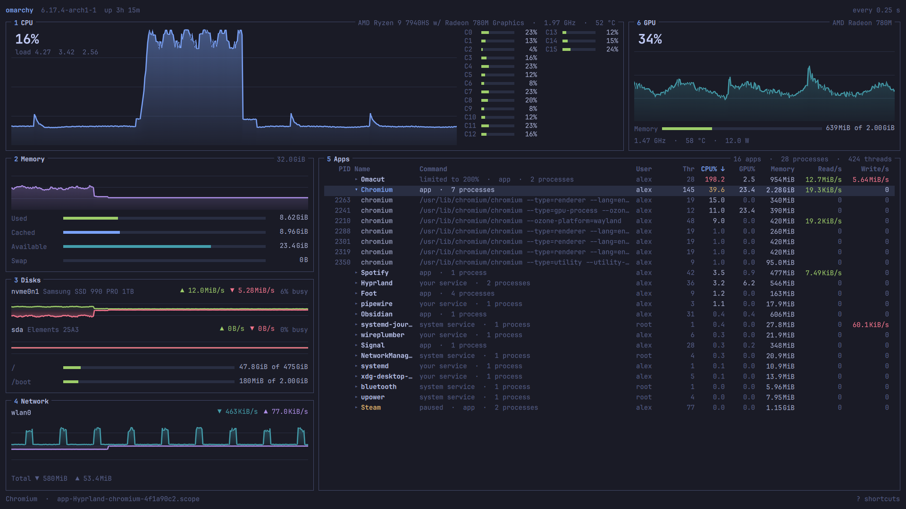
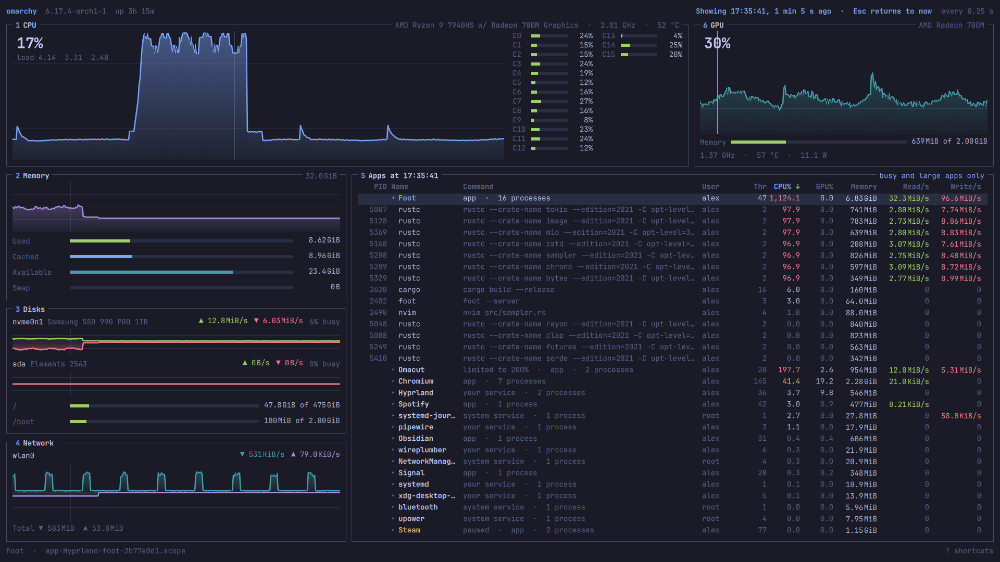
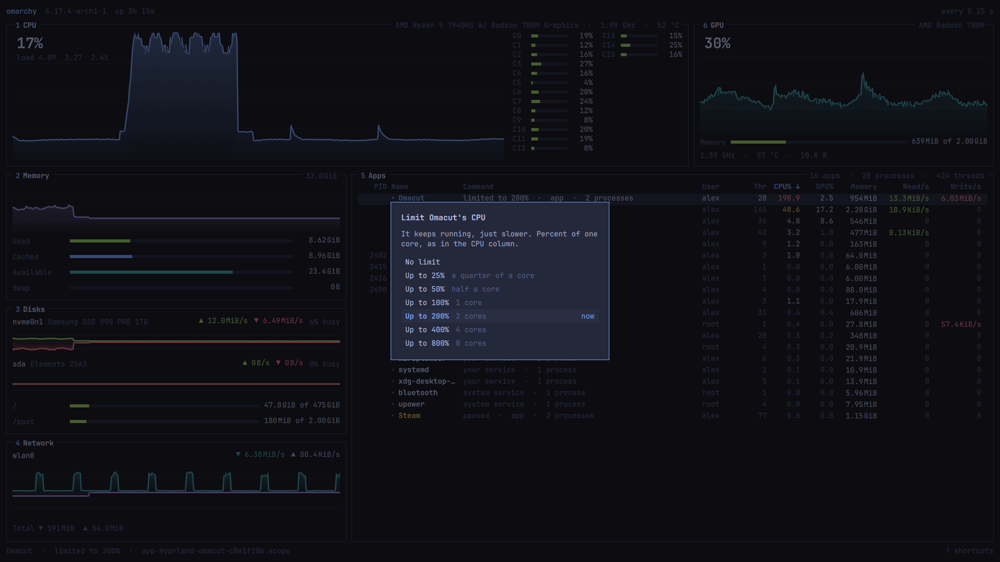
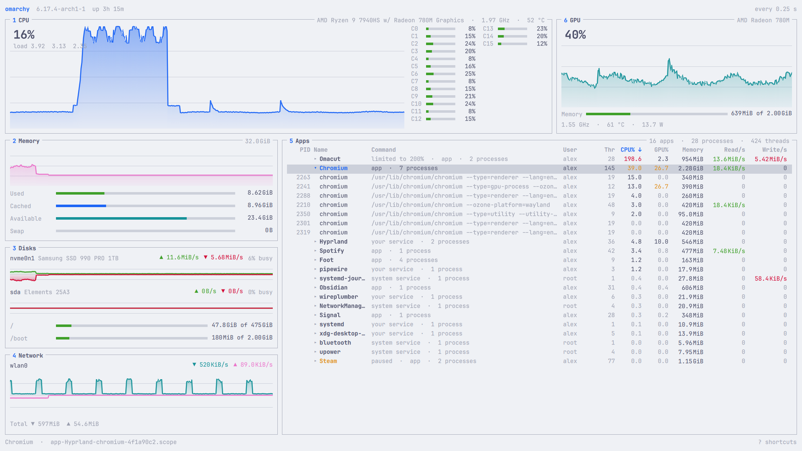
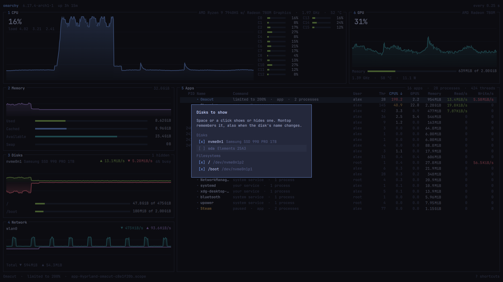

# Montop

**A system monitor for [Omarchy](https://github.com/omacom/omarchy) that shows apps, not just processes.**
See what your machine is doing, find out what caused the spike you just
missed, and pause the app hogging your CPU instead of killing it.



Montop is in the spirit of htop, bpytop, and btop, but built for the Omarchy
desktop: one keyboard-driven window, drawn on the GPU, following your theme,
font, and language as they change.

## What makes it different

**Apps, not a wall of processes.** Your browser's forty helpers are one row,
and the shells and builds in a terminal belong to that terminal. Montop groups
processes by the systemd cgroups Omarchy launches every app in, and takes each
app's totals straight from the kernel's per-cgroup counters, which include
children that already exited and count shared memory once. Open an app with
`→` to see its processes, or press `a` for the classic flat list.

**Rewind.** A spike is usually over by the time you open a monitor. Montop keeps
the last ten minutes: point at any moment on the CPU, memory, or disk graph to
see which apps were behind it, click (or press `[`) to see the whole list as it
was then, and `Esc` to come back.



**Pause or slow down an app instead of killing it.** `p` freezes every process
in an app until you press `p` again; `c` caps how much CPU it may use. A video
export can keep going on two cores while you work; a game launcher can sit
frozen until you want it back. Nothing is lost, and both undo themselves when
Montop closes. It needs no root: it goes through systemd's user manager.



**Measure a command.** `montop run` is `time` for things that fan out into many
processes, such as builds and test suites:

```
$ montop run make -j8
...
montop run: make -j8
  Time       9.85 s
  CPU        53.3 s of CPU time (user 52.0 s, system 1.36 s), 5.4 cores on average, 8.0 at the peak
  Memory     peak 2.22 GiB, 2.29 GiB with file cache
  Disk       read 0 B, wrote 0 B
  Waited     on CPU 0.00 s, on memory 0.00 s, on disk 0.00 s
  Processes  26 at most at once
  Exit       0
```

**Built for agents, too.** Every command works without a display and speaks
JSON, and `montop skill install` teaches your coding agents to use it: ask
your agent why the machine is slow, and it can answer with the app, not a PID.
The package ships the skill in `/usr/share/montop/skills/montop`, and
`montop skill install` links it, the way Omarchy links its own skills, into
`~/.agents/skills` and the skills folder of each agent you use (Claude Code,
Codex, Pi, Gemini, Hermes), so it stays current with every upgrade.
`montop skill remove` takes the links out again.

**The GPU too, app by app.** Next to the CPU, every GPU shows how busy it is,
its memory, clock, temperature, and power, and the app list gains a GPU%
column: the browser decoding a video, the compositor, a game. Pointing at the
GPU graph names the apps behind a spike, as it does for the CPU. A discrete GPU
that's powered down stays asleep: Montop reads nothing that would wake it.

**At home on Omarchy.** Montop follows the current theme live, the whole
palette, light or dark, along with Hyprland's window rounding, the desktop's
monospace font, and the language picked under Setup > Language.



## Install

Montop isn't in Omarchy's package repository yet. To build and install it from
source on Omarchy (everything it needs is already there):

```sh
git clone https://github.com/carroarmato0/montop.git
cd montop
bin/install    # builds, then installs the package with pacman (asks for sudo)
```

Then open it from the app launcher (`Super + Space`, Montop), or run
`montop open`.

On another Arch-based system you need `qt6-base`, `qt6-declarative`,
`qt6-wayland`, `hwdata` (for GPU names), `make`, and a C++17 compiler. Montop reads Linux's `/proc` and
`/sys` and uses systemd's cgroups for apps, pausing, and limiting; it runs
anywhere with cgroups v2, and falls back to plain processes without them.

## Use

| Key | Action |
| --- | --- |
| `?` | Show or hide shortcuts |
| `↑` `↓` / `j` `k` | Select an app or process |
| `→` `←` / `l` `h` / `Enter` | Open or close an app |
| `a` | Show apps, or every process |
| `/` | Filter by name, command, user, or PID |
| `s` / `r` | Sort by the next column (or click a header) / reverse the sort |
| `[` `]` / `{` `}` | Rewind or go forward 10 s, or a minute |
| `Esc` | Return to now, clear the filter, close the shortcuts |
| `p` | Pause or resume the selected app |
| `c` | Limit the selected app's CPU |
| `x` / `Shift X` | End (SIGTERM) or kill (SIGKILL) the selected app or process, after asking |
| `Space` | Pause or resume updates |
| `+` / `-` | Sample less or more often (0.125 s to 4 s; 0.25 s by default) |
| `1` – `6` | Show or hide CPU, memory, disks, network, apps, GPU |
| `d` | Choose the disks and filesystems to show (or right-click one to hide it) |
| `PgUp` `PgDn` / `g` `G` | Move a page / go to the first or last row |
| `Shift K` | Show or hide kernel threads |
| `q` | Quit |

CPU% is measured against one core, as in top and htop: an app busy on two cores
shows 200.

Montop remembers the panels you show, the sort, apps or every process, kernel
threads, the update speed, and the disks and filesystems you hid, in
`~/.config/montop/settings.conf`. A hidden disk is remembered by its WWID or
serial number, and a filesystem by its UUID, so they stay hidden when `sdb`
becomes `sdc` or a btrfs subvolume is mounted elsewhere. Hiding only affects the
window: `montop snapshot` still reports every disk.



### From the command line

```sh
montop snapshot                 # CPU, memory, disks, network, busiest apps and processes
montop snapshot --json --sort gpu --top 20
montop apps --json              # every app and service, with its PIDs and top processes
montop pause steam              # freeze an app until: montop resume steam
montop limit omacut 200         # cap it at two cores until logout; montop limit omacut off
montop run cargo build          # run a command, then report what it used
montop skill install            # teach your coding agents to use Montop (skill remove undoes it)
```

Commands need no display. Each takes `--json`, exits 0 or 1 (`montop run`
exits with the command's own code), and writes errors to stderr. `montop help
<command>` lists a command's options. `montop open` opens the window.

## How it works

**Apps.** systemd runs every app Omarchy launches in its own cgroup, named after
the app (`app-Hyprland-chromium-4f1a.scope`), and every service in one named
after the service. Montop groups processes by cgroup and names each group from
its desktop entry. Its numbers come from the cgroup's own counters, which are
exact where adding up processes is not. App memory leaves out the page cache,
which the kernel hands back on demand.

**Rewinding.** Each process scan (once a second) is kept for ten minutes: every
app and process that was busy, and the twenty largest of each, about 10 MB in
all. Ending, pausing, or limiting is refused while you look at the past, since
its process IDs may belong to other processes by now. The history lives only
while the window is open.

**Pausing and limiting.** These freeze the app's cgroup and set its `CPUQuota`
through `systemctl --user freeze` and `set-property --runtime`, so systemd stays
in charge. Montop acts only on your apps (`app.slice`) and background services
(`background.slice`). It refuses the desktop's own services in `session.slice`
(the compositor, D-Bus, audio, portals), since freezing those would freeze the
session; system services, which need root; and the app Montop itself runs in,
such as the terminal you started it from.

**GPUs.** Each driver reports differently, and Montop takes what each offers:

| GPU | Busy | Per app | Memory, clock, sensors |
| --- | --- | --- | --- |
| AMD (`amdgpu`) | the driver's own busy counter | yes | VRAM, clock, temperature, power, fan |
| Intel (`i915`, `xe`) | its busiest engine | yes | clock; sensors on discrete cards |
| NVIDIA (proprietary driver) | through NVIDIA's NVML library, loaded if installed | yes | VRAM, clock, temperature, power, fan |
| Snapdragon (Adreno), Mali | its busiest engine | yes | clock |
| Apple Silicon (Asahi Linux) | not reported by its driver | no | none |

Per-app usage comes from the kernel's per-client counters in
`/proc/<pid>/fdinfo` (NVML for NVIDIA), so it covers your own processes. A GPU%
is of one GPU, as CPU% is of one core. On a GPU that shares memory with the CPU,
the memory shown is what the apps' GPU buffers hold.

**Arm and Macs.** Montop builds and runs its tests on Arm (`aarch64`) in CI. On
Arm, the CPU panel names the machine (`Apple MacBook Air (M2, 2022)`) or the
chip (`Snapdragon X1E80100`), and reads the CPU temperature from the SoC's
thermal zones; Apple's chips report none on Linux, so none is shown. The Disks
panel leaves out the internal namespaces Apple's SSD shows Linux next to its
main one (`nvme0n2`, `nvme0n3`), unless they're partitioned or in use. Intel Macs
are ordinary Intel or AMD hardware to Montop.

**Measuring a command.** `montop run` starts the command in a systemd scope of
its own, so its cgroup counts everything it starts. Peak memory is what the
command held itself (sampled four times a second), with the kernel's exact peak
including file cache beside it; the waits come from the cgroup's pressure
counters. The report goes to stderr so the command's output is untouched, and
Ctrl+C stops the command but still prints the report.

**Drawing.** Graphs are scene-graph geometry drawn by the GPU, and scroll
smoothly between samples at a fixed 2 pixels per sample, so a wider window shows
more history. A frame is drawn only when something moves by a whole pixel, which
keeps Montop at about 4 % of one core. The app list refreshes once a second,
since a table rewritten faster than that can't be read.

**Privacy.** Montop only reads what Linux already shows every user, sends
nothing anywhere, and keeps its history in memory.

## Develop

```sh
bin/build      # build/montop
bin/test       # Qt Test, offscreen
bin/install    # makepkg -fsi: installs the binary, icon, and launcher entry
bin/package-check   # builds and tests it in Omarchy's package builder (rootless Podman)
```

The recipe for [Omarchy's package repository](https://github.com/omacom/omarchy-pkgs)
lives in `pkgbuild/omarchy-pkgs/`; `bin/package-check --release` builds it
exactly as published.

The screenshots come from a made-up system, so they show nothing of the machine
they were taken on. `tools/demo/montop-demo.py ROOT` writes a stand-in `/proc`
and `/sys` and keeps it moving; `MONTOP_ROOT=ROOT montop open` watches it, and `MONTOP_THEME` points at another
theme (a directory holding a `theme` folder, like `~/.local/state/omarchy/current`).
`tools/demo/screenshots.py` retakes every screenshot on a Hyprland desktop
(it needs `wtype` and `grim`, and four minutes without touching the mouse).

## Formerly Vitals

Montop was called Vitals up to 0.4.2, and was renamed because several Omarchy
plugins share that name. To switch, remove the old package and install Montop:
`sudo pacman -R vitals`, then install as above. `montop skill install` replaces
the old skill links for your coding agents.

## License

[MIT](LICENSE). The theme and language following is adapted from Omacut and
Monologue, and the command line follows Hype, all by David Heinemeier Hansson
under the MIT license.
